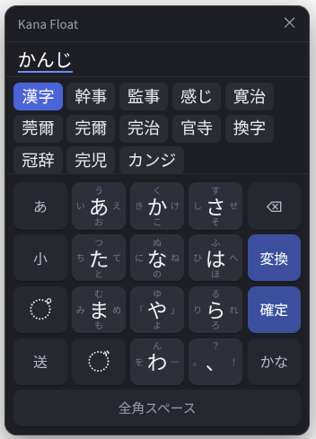

# Kana Float

A floating, mouse-driven Japanese kana keyboard for Brave and other Chromium
browsers, with offline kanji conversion from the SKK dictionary.



## Why I made this

I am learning Japanese by chatting with LLMs. I want to write my side of the
conversation in Japanese, kanji included, but I do not want to switch my
system keyboard layout or install an IME: my physical keyboard stays in
English for everything else I do all day.

So this extension puts a small Japanese keyboard on top of the page. I click
kana with the mouse, convert words to kanji the SKK way, and the text goes
straight into the chat box. The physical keyboard keeps working as usual
(Enter still sends the message).

Clicking every kana also turns out to be good practice: you have to know which
row a sound lives in, and you see the kanji candidates for each word you type.

## Features

- iPhone-style 12-key kana grid. Click for the あ-column kana; press and hold
  to get a cross-shaped popup, then drag toward the vowel you want
  (left い, up う, right え, down お). A quick drag (flick) works without
  waiting for the popup. Small hints on each key show what is where.
- ゛ ゜ 小 keys (shown as ◌゙ ◌゚ 小) that toggle the kana before the caret: か→が→か, は→ぱ,
  ば→ぱ, つ→っ, や→ゃ, う→ゔ, and so on.
- Hiragana / katakana switch (the あ / ア key).
- Punctuation: 、 。 ？ ！ on the 、 key, 「 」 on the や key, ー on the わ key,
  plus a full-width space bar.
- SKK-style conversion, word by word, fully offline, with the 147,000-reading
  SKK-JISYO.L dictionary. Okurigana are supported (書く, 言った).
- Remembers the candidates you pick and ranks them first next time.
- Remembers where you dragged it.
- Works in `input` (text, search, url, email, tel), `textarea` and
  `contenteditable` fields, including React/Vue apps such as LLM chat UIs.
- Never acts on password fields.
- No network access, no analytics, no telemetry. Only the `activeTab` and
  `scripting` permissions; nothing runs until you activate it in a tab.

## How to use

1. Click into a text field on the page (for example a chat box).
2. Press **Alt+K** or click the toolbar icon. The keyboard appears at the
   bottom right. Drag it by its header; double-click the header to reset its
   position. Alt+K again (or ×) hides it.
3. Type a word in kana. It goes into the keyboard's preedit line first, not
   into the page.
4. Then either:
   - press **変換** to look up kanji. Press 変換 again to cycle, or click a
     candidate to select it, then press **確定** (or click the selected
     candidate again) to insert it; or
   - press **かな** to insert the word as kana (katakana if you are in ア mode).

   If the word is not in the dictionary, its katakana spelling is offered as
   a candidate, which covers most loanwords (ラーメン).
5. With an empty preedit line, keys type straight into the page, and ⌫,
   ゛, ゜ and 小 act on the character before the caret.

Typing another kana while candidates are showing commits the selected
candidate and starts the next word, so you can type phrase by phrase:
`かんじ` 変換 `を` ... Punctuation commits the pending word and then inserts
itself.

### Verbs and adjectives (okurigana)

SKK needs to know where the kanji stem ends. Type the stem, press **送**,
then type the ending:

| You type | Looked up as | Result |
| --- | --- | --- |
| か 送 く | `かk` | 書く, 掛く, 欠く ... |
| あ 送 う | `あu` | 会う, 合う ... |
| い 送 つ 小 た | `いt` | 言った, 行った ... |
| たか 送 い | `たかi` | 高い |

Only the first kana after 送 matters for the lookup; everything after it is
kept as typed. Press 送 again to remove the mark.

## Install (load unpacked)

The dictionary JSON is committed, so a clone works as is.

1. Clone this repository.
2. Open `brave://extensions` (or `chrome://extensions`).
3. Turn on **Developer mode** (top right).
4. Click **Load unpacked** and select the repository folder (the one with
   `manifest.json`).
5. Optional: pin the icon. To change the shortcut, open
   `brave://extensions/shortcuts`.

After `git pull`, press the reload button on the extension's card and reload
the pages you use it on.

## Rebuild the dictionary

Only needed to update the dictionary. Requires bash, `iconv` and awk.

```bash
# Download the raw dictionary (about 4.5 MB, EUC-JP) into its own directory
mkdir -p dict-raw
curl -fL -o dict-raw/SKK-JISYO.L https://raw.githubusercontent.com/skk-dev/dict/master/SKK-JISYO.L

# Convert it to dict/skk-jisyo-l.json (about 5.6 MB)
scripts/build-dict.sh
```

`dict-raw/` is git-ignored. See [`dict/README.md`](dict/README.md) for what the
conversion keeps and drops.

## Tests

```bash
# Syntax check
for f in *.js scripts/*.js tests/*.js tests/*.mjs; do node --check "$f"; done

# Unit tests: kana transforms, flick directions, the conversion state machine,
# the generated dictionary, and the service worker's lookup/learning logic
node --test tests/*.test.js

# End-to-end in a real headless browser (Chromium by default, or pass Brave)
node tests/e2e.mjs
node tests/e2e.mjs /usr/bin/brave
```

The end-to-end test loads a temporary copy of the extension in a throwaway
profile, injects it through the real service worker, clicks keys with real
mouse events on a page with a strict CSP and Trusted Types, and checks
conversion, kana commits, learning, toggling, a real service worker
restart and password fields. Its copy adds a `127.0.0.1` host permission,
because `activeTab` is only granted by a real toolbar click or shortcut, which
automation cannot produce.

## Known limits

- It cannot run on the address bar, `brave://` and `chrome://` pages, the
  Chrome Web Store, the built-in PDF viewer, or other pages where browsers
  block extensions. The icon shows a red × there.
- Canvas-based editors such as Google Docs do not use real text fields, so
  insertion does not work there.
- Top frame only: fields inside iframes (cross-origin or not) are not
  supported in this version.
- It has to be activated again after a page navigates or reloads
  (that is how `activeTab` works).
- Not published on the Chrome Web Store; load it unpacked.
- Conversion is word by word (SKK style), not whole-sentence like a full IME.
  Number conversions (`#` entries) and SKK Lisp candidates are not supported.
- Learned candidates and the keyboard position are kept in the extension's own
  IndexedDB in your browser profile (no `storage` permission needed). They
  are deleted when the extension is removed.

## Files

| File | Purpose |
| --- | --- |
| `manifest.json` | Manifest V3; `activeTab` + `scripting`, Alt+K |
| `background.js` | Service worker: injection, dictionary lookups, learning |
| `kana.js` | Pure logic: flick layout, kana transforms, conversion state machine |
| `content.js` | The keyboard UI (closed Shadow DOM) and text insertion |
| `scripts/build-dict.sh` | Raw SKK-JISYO.L to `dict/skk-jisyo-l.json` |
| `scripts/make-icons.js` | Regenerates the toolbar icons |
| `dict/` | Generated dictionary and its license |
| `tests/` | Unit and end-to-end tests |

## License

GPL-2.0-or-later, the same license as the SKK dictionary it ships. See
[`LICENSE`](LICENSE). Dictionary data: Copyright (C) the SKK Development Team
and contributors; see [`dict/README.md`](dict/README.md).
